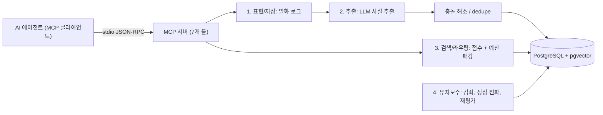
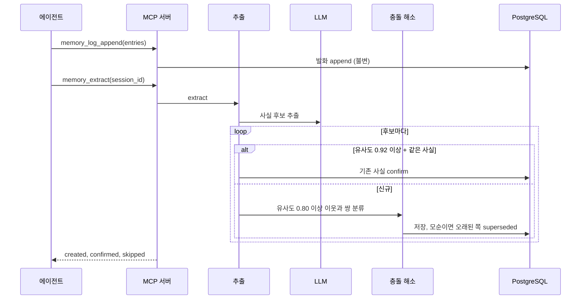

# agent-memory-store

AI 에이전트(Claude Code 등)가 세션을 넘어 기억을 저장하고 다시 꺼내 쓰게 해 주는 전용 메모리 서버입니다.

## 왜 만들었나

AI 에이전트는 세션이 끝나면 다 잊습니다. 흔한 해결책은 CLAUDE.md 같은 파일 몇 개를 두거나, 대화 로그를 벡터DB에 통째로 넣는 것입니다. 그러면 같은 내용을 매번 다시 알려줘야 하고, 몇 달 전 결정은 찾기 어렵고, 이미 틀린 기억이 계속 검색됩니다.

이 프로젝트는 논문 arXiv:2606.24775의 4모듈 구조(표현/저장, 추출, 검색/라우팅, 유지보수)를 구현합니다. 특히 일반 RAG(검색 증강 생성)에는 없는 유지보수 모듈 - 모순 해소, 오래된 기억의 망각, 정정 전파 - 에 비중을 둡니다.

## 주요 기능

- 원문 무손실 보관 - 세션 발화 로그는 DB 트리거로 UPDATE/DELETE가 막힌 append-only 테이블입니다.
- 사실(fact) 추출 - LLM이 로그에서 기억할 가치가 있는 사실만 뽑고, 모든 사실은 출처 발화에 링크됩니다.
- 가중치 검색 - 유사도, 최근성, 신뢰도를 섞어 점수를 매기고 토큰 예산 안에 맞춰 반환합니다.
- 모순 해소 - 새 사실이 기존 사실과 충돌하면 규칙에 따라 승자를 정하고 패자는 superseded 상태로 남깁니다.
- 소프트 망각 - 유형별 반감기로 오래된 사실을 expired 처리합니다. 삭제하지 않습니다.
- 정정 전파 - 사실이 정정되면 관련 사실을 관계 그래프 깊이 2까지 needs_review로 표시하고 재평가합니다.
- MCP 서버 - 7개 툴을 노출하므로 MCP(Model Context Protocol) 클라이언트라면 어디서든 쓸 수 있습니다.
- 벤치마크 - MemFail 스타일 시나리오 30개 중 30개 통과 (fake 프로바이더 기준, 아래 참고).

## 동작 방식



핵심 흐름인 기억 저장(발화 로그 - 추출 - 중복/충돌 판정 - 저장)은 다음과 같습니다.



1. 표현/저장 - 세션 원문 로그를 그대로 보관하고, 추출된 사실을 출처 발화 링크와 상태 이력(active, superseded, retracted, expired)과 함께 저장합니다. 상태는 모두 소프트 상태라 행이 삭제되지 않습니다. 재검토가 필요한 사실에는 별도로 needs_review 플래그가 붙습니다.
2. 추출 - 초기 confidence는 명시된 사실 0.9, 추론된 사실 0.6입니다. 임베딩 유사도 0.92 이상이면 중복으로 보고 새로 만들지 않고 기존 사실을 확인(confirm) 처리합니다.
3. 검색/라우팅 - `score = 0.55*유사도 + 0.25*최근성 + 0.20*신뢰도`로 랭킹합니다. 최근성은 유형별 반감기로 감쇠하고, needs_review 사실은 점수가 0.5배가 됩니다. 결과는 토큰 예산(기본 2000, 최대 8000) 안에서 그리디로 채웁니다.
4. 유지보수 - 충돌 시 우선순위는 명시적 정정 > 최신 세션 > 최신 발화입니다. 망각은 감쇠 점수가 0.15 미만이면 expired로 전이합니다. 유지보수 잡은 매일 03:00에 돌고, `POST /internal/maintenance/run`으로 수동 실행할 수 있습니다.

유형별 반감기(일): preference 180, constraint 180, decision 90, event 30, entity 365. 값은 `src/main/resources/application.yml`에 있습니다.

## 벤치마크 결과

MemFail(arXiv:2605.26667) 원본 데이터셋은 통합하지 못해, 같은 실패 유형을 겨냥한 자체 시나리오 30개를 만들었습니다(사유는 [bench/MEMFAIL-NOTES.md](bench/MEMFAIL-NOTES.md)). 판정은 기대 id/키워드 포함 여부, 결과 개수, 토큰 예산 같은 결정적 기준이라 LLM 심판 없이 돌아갑니다.

| 카테고리 | 검증하는 실패 유형 | 통과 / 전체 | 비율 |
|---|---|---|---|
| contradiction | 새 사실이 모순되는 옛 사실을 대체하는가 | 10 / 10 | 100% |
| correction | 명시적 정정이 대상을 철회하고 이기는가 | 8 / 8 | 100% |
| decay | 오래된 사실이 활성 검색에서 빠지는가 | 6 / 6 | 100% |
| provenance | 회수된 사실이 출처 발화를 추적할 수 있는가 | 3 / 3 | 100% |
| budget | 검색이 토큰 예산을 지키는가 | 3 / 3 | 100% |
| overall | | 30 / 30 | 100% |

- 이 결과는 fake LLM/임베딩 프로바이더(결정적) 기준입니다. 실제 모델로는 아직 검증하지 않았습니다.
- 검색 지연: 사실 10,000건에서 p95 22.5ms (외부 임베딩 API 호출 제외, 기준 500ms).
- 전체 리포트: [bench-report.md](bench-report.md)

## 데모 출력 예시

3월/5월/6월 3개 세션을 시드하고 4개 질의를 실행합니다. 3월 "PostgreSQL 15 + AWS", 5월 "스페이스 선호", 6월 "PostgreSQL 17로 마이그레이션 + 선호 정정"입니다.

```
[Q1 | conflict resolution] query: 'PostgreSQL version'
  - [decision] We decided to migrate to PostgreSQL version 17 (conf=0.90, score=0.835)
  - [decision] We decided to deploy on AWS (conf=0.90, score=0.709)
  - [preference] The team prefers tabs over spaces for indentation (conf=0.95, score=0.708)

[Q2 | provenance + supersede history] inspect the superseded PostgreSQL 15 fact
  statement: We decided to use PostgreSQL version 15
  status: superseded  superseded_by: 3b532f64-...
  provenance: session=710151a7-... seq=0 "We decided to use PostgreSQL version 15"

[Q3 | budget packing] query: 'project decisions' budget_tokens=20
  estimated_tokens=14
  - [preference] The team prefers tabs over spaces for indentation (conf=0.95, score=0.718)

[Q4 | correction reflected] query: 'indentation preference'
  - [preference] The team prefers tabs over spaces for indentation (conf=0.95, score=0.775)
  ...
```

- Q1 - PostgreSQL 질의에 17이 최상위로 나오고, 15는 supersede되어 나오지 않습니다.
- Q2 - inspect가 15 사실의 superseded 상태, 승자 포인터, 출처 발화를 보여줍니다.
- Q3 - 낮은 예산(20 토큰)에서는 상위 1건만 들어갑니다.
- Q4 - 정정된 선호(탭)가 반영됩니다.

## 빠른 시작

요구사항: Java 21, Docker.

```bash
# 1. PostgreSQL 16 + pgvector 기동 (포트 5432)
docker compose up -d

# 2. 서버 기동 - /actuator/health 가 UP을 반환
./gradlew bootRun

# 3. 데모 실행 (DB가 떠 있어야 함)
bash demo/run-demo.sh

# 4. 벤치마크 실행 - 결과는 bench-report.md에 기록
./gradlew benchRun
```

기본값은 fake 프로바이더라 API 키 없이 결정적으로 돌아갑니다. 실제 모델을 쓰려면 환경변수를 지정합니다.

| 환경변수 | 용도 |
|---|---|
| `MEMSTORE_LLM_PROVIDER=claude`, `ANTHROPIC_API_KEY`, `MEMSTORE_LLM_MODEL` | LLM (Claude Messages API) |
| `EMBEDDING_PROVIDER=openai`, `EMBEDDING_API_KEY`, `EMBEDDING_MODEL`, `EMBEDDING_DIM` | 임베딩 |
| `MEMSTORE_DB_URL`, `MEMSTORE_DB_USER`, `MEMSTORE_DB_PASSWORD` | DB 접속 (기본 localhost:5432/memstore) |

### MCP 등록

MCP 서버는 stdio 전송을 씁니다. jar를 빌드한 뒤 Claude Code 등에 등록합니다.

```bash
./gradlew bootJar
claude mcp add memstore -- java -Dmemstore.mcp.stdio=true -jar build/libs/agent-memory-store-0.1.0.jar
```

| 툴 | 하는 일 |
|---|---|
| `memory_log_append` | 세션 발화를 로그에 추가 |
| `memory_extract` | 세션 로그에서 사실 추출 |
| `memory_search` | 점수 + 토큰 예산 기반 검색 |
| `memory_save_fact` | 사실을 직접 저장 |
| `memory_correct` | 사실을 정정하고 전파 |
| `memory_forget` | 사실을 망각 처리 |
| `memory_inspect` | 사실의 상태 이력과 출처 조회 |

## 테스트

```bash
./gradlew test
```

- 단위 테스트는 키 없이 통과합니다. 통합 테스트는 Docker가 있으면 Testcontainers로 실행되고, 없으면 자동 skip됩니다.
- 외부에서 띄운 DB를 쓰려면 `-Dmemstore.test.jdbcUrl=jdbc:postgresql://localhost:5432/memstore`를 넘깁니다.
- GitHub Actions(`.github/workflows/ci.yml`)가 push/PR마다 `./gradlew test`를 실행합니다.
- 사후 그릴링 시점 기록: 41 tests, 0 skipped, 0 failures ([.planning/grilling-post-impl.md](.planning/grilling-post-impl.md)).

## 기술 스택

Java 21, Spring Boot 3.3, PostgreSQL 16 + pgvector, Flyway, Testcontainers, jqwik(property 기반 테스트). LLM과 임베딩은 프로바이더 인터페이스로 추상화했고, MCP 서버는 JSON-RPC를 직접 구현했습니다.

## 프로젝트 구조

```
agent-memory-store/
├── src/main/java/dev/nini/memstore/
│   ├── domain/        # 엔티티 (session, utterance, fact, relation)
│   ├── service/       # 로그 저장, FactStore
│   ├── extraction/    # 추출, 충돌 해소, 정정 전파
│   ├── search/        # 점수 계산, 예산 패킹, 벡터 검색
│   ├── maintenance/   # 감쇠, 재평가, 유지보수 잡
│   ├── mcp/           # MCP 서버 (stdio)
│   ├── llm/           # Claude / fake LLM 클라이언트
│   ├── embedding/     # OpenAI / fake 임베딩
│   ├── bench/         # 벤치마크 하니스
│   └── demo/          # 데모 러너
├── src/main/resources/db/migration/  # Flyway V1~V4
├── bench/scenarios/   # 벤치 시나리오 YAML 5개
├── demo/run-demo.sh
└── .planning/         # 명세, plan, 사후 그릴링
```

## 더 읽을거리

- [docs/SRS.md](docs/SRS.md) - 요구사항 명세
- [docs/SDS.md](docs/SDS.md) - 설계 명세: 구성도, 시퀀스, ERD/자료구조, 모듈
- [.planning/SPEC.md](.planning/SPEC.md) - 요구사항과 수용 기준
- [.planning/grilling-post-impl.md](.planning/grilling-post-impl.md) - 구현 후 기준별 검증, 발견 결함, 남은 설계 갭
- [bench/MEMFAIL-NOTES.md](bench/MEMFAIL-NOTES.md) - MemFail 조사 기록
- [bench-report.md](bench-report.md) - 벤치마크 리포트
- 논문: arXiv:2606.24775 (4모듈 구조), arXiv:2605.26667 (MemFail)
