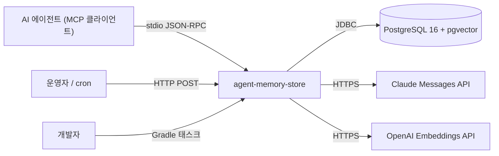
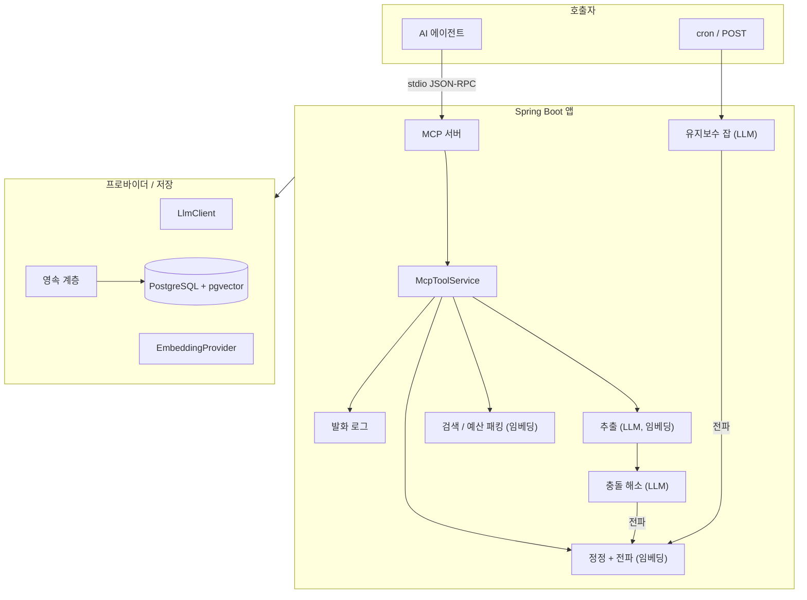
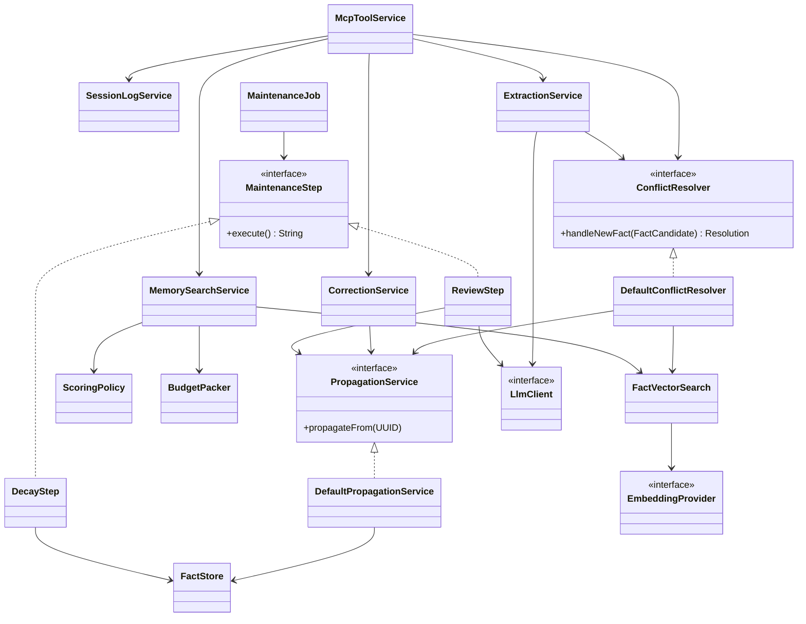
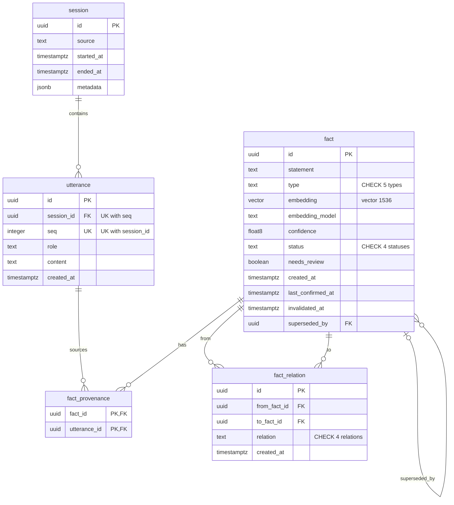
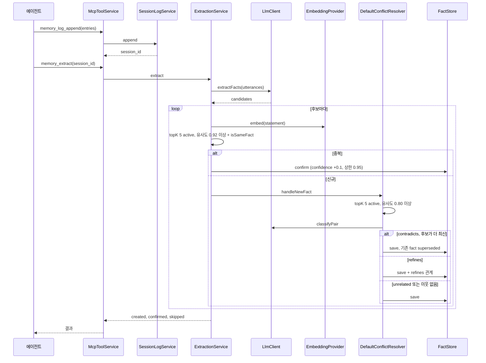
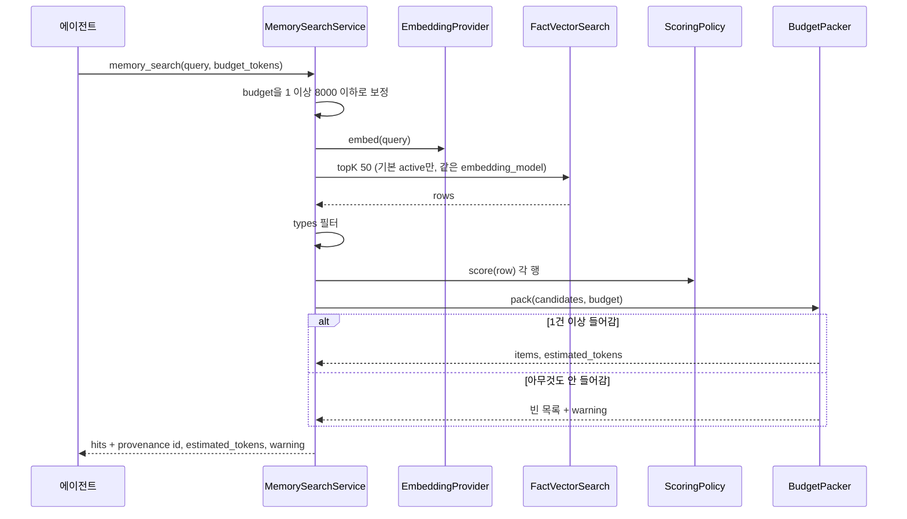
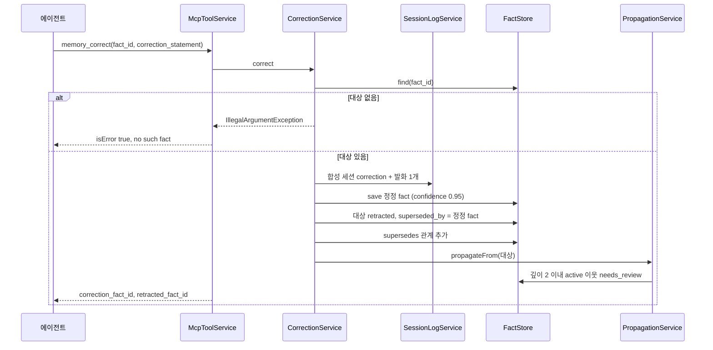
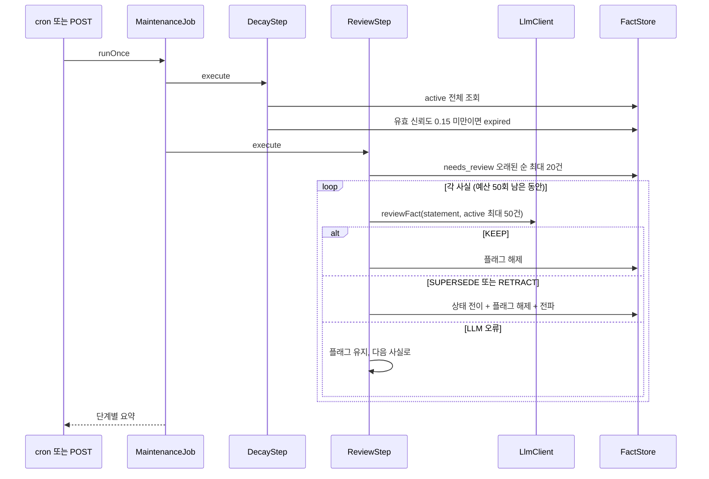
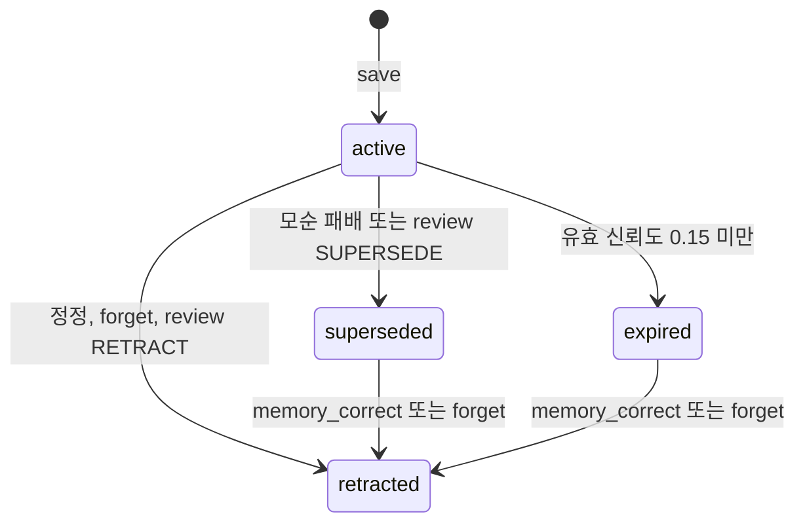

# agent-memory-store 소프트웨어 설계 명세서 (SDS)

| 문서 | 버전 | 작성일 | 기준 표준 |
|---|---|---|---|
| agent-memory-store SDS | 1.0 | 2026-11-18 | IEEE 1016-2009 |

## 1. 소개

### 1.1 목적

이 문서는 [SRS.md](SRS.md)의 요구사항을 agent-memory-store가 어떤 구성 요소, 데이터, 흐름, 알고리즘으로 구현하는지 설명합니다.

### 1.2 범위

MCP 서버, 4모듈(표현/저장, 추출, 검색/라우팅, 유지보수), LLM/임베딩 프로바이더, PostgreSQL 스키마, 벤치마크 하니스와 데모 러너를 다룹니다. 코드는 `src/main/java/dev/nini/memstore/` 아래에 있고, 스키마는 `src/main/resources/db/migration/V1~V4`입니다.

### 1.3 용어 정의

[SRS 1.4 용어 정의](SRS.md#14-용어-정의)를 따릅니다.

### 1.4 참고 문서

| 문서 | 내용 |
|---|---|
| [SRS.md](SRS.md) | 요구사항 명세와 추적표 |
| [README.md](../README.md) | 개요, 빠른 시작, 데모 출력 예시 |
| [.planning/SPEC.md](../.planning/SPEC.md) | 원본 요구사항 |
| [.planning/grilling-post-impl.md](../.planning/grilling-post-impl.md) | 구현 후 검증 기록과 남은 설계 갭 |
| [bench-report.md](../bench-report.md) | 벤치마크 결과 |
| arXiv:2606.24775 | 4모듈 구조 |

## 2. 설계 이해관계자와 관심사

| 이해관계자 | 관심사 | 다루는 뷰 |
|---|---|---|
| AI 에이전트 (MCP 클라이언트) | 어떤 툴을 어떤 인자로 부르고 무엇을 받는가 | 3.5 인터페이스, 3.6 상호작용 |
| 개발자 | 모듈 책임, 클래스 관계, 확장 지점(프로바이더, 유지보수 단계) | 3.2 구성, 3.3 논리, 3.8 알고리즘 |
| 운영자 | DB, 포트, 스케줄, 외부 API 키 | 3.1 컨텍스트, 3.9 자원 |
| 검증자 | 상태 전이, 불변식(무손실, provenance), 오류 동작 | 3.4 정보, 3.7 상태 동적, 5 오류 처리 |

## 3. 설계 뷰

### 3.1 컨텍스트 뷰



| 외부 요소 | 관계 |
|---|---|
| AI 에이전트 | `-Dmemstore.mcp.stdio=true`로 띄운 프로세스의 stdin/stdout으로 JSON-RPC를 주고받습니다. |
| 운영자 / cron | `POST /internal/maintenance/run`으로 유지보수 잡을 실행합니다. 내부 스케줄러는 매일 03:00에 실행합니다. |
| 개발자 | `benchRun`, `demoRun`, `test` 태스크를 실행합니다. |
| PostgreSQL + pgvector | 모든 상태를 저장합니다. 스키마는 Flyway가 관리합니다. |
| Claude / OpenAI API | `MEMSTORE_LLM_PROVIDER=claude`, `EMBEDDING_PROVIDER=openai`일 때만 호출합니다. 기본값은 fake입니다. |

### 3.2 구성 뷰



괄호는 각 서비스가 호출하는 프로바이더입니다. 발화 로그, 검색, 충돌 해소, 정정, 유지보수 잡은 영속 계층을 거쳐 PostgreSQL에 씁니다.

| 구성 요소 | 역할 | 기술 |
|---|---|---|
| MCP 서버 | stdio에서 줄 단위 JSON-RPC를 읽고 `initialize`, `tools/list`, `tools/call`을 처리 | `McpStdioServer`, `McpServer`, Jackson |
| McpToolService | 7개 툴의 인자를 파싱하고 서비스에 위임, 결과를 맵으로 반환 | Spring `@Service` |
| 발화 로그 (표현/저장) | 세션 생성, 발화 append, 순번 부여 | `SessionLogService`, JPA |
| 추출 | LLM 사실 추출, 출처 검증, 임베딩, dedupe | `ExtractionService` |
| 충돌 해소 | 후보 창 검색, LLM 쌍 분류, 우선순위 규칙 적용 | `DefaultConflictResolver` |
| 정정 + 전파 | 명시적 정정, 관계 그래프 깊이 2 needs_review 전파 | `CorrectionService`, `DefaultPropagationService` |
| 검색 / 예산 패킹 (검색/라우팅) | 벡터 topK, 가중 점수, 그리디 패킹 | `MemorySearchService`, `ScoringPolicy`, `BudgetPacker`, `TokenEstimator` |
| 유지보수 잡 (유지보수) | 감쇠 단계 후 재평가 단계 실행, LLM 호출 상한 | `MaintenanceJob`, `DecayStep`, `ReviewStep`, `LlmCallBudget`, `MaintenanceController` |
| 영속 계층 | fact/provenance/relation 저장, 상태 전이, provenance 불변식, pgvector 질의 | `FactStore`, `FactVectorSearch`, Spring Data JPA, `JdbcTemplate` |
| LlmClient | 추출, 동일성, 쌍 분류, 정정 감지, 재평가 | `ClaudeLlmClient`, `FakeLlmClient` |
| EmbeddingProvider | 텍스트 임베딩과 모델 id | `OpenAiEmbeddingProvider`, `FakeEmbeddingProvider` |
| PostgreSQL + pgvector | 5개 테이블, HNSW 코사인 인덱스, utterance 불변 트리거 | PostgreSQL 16, pgvector, Flyway |

모듈/파일별 책임:

| 패키지 / 파일 | 책임 | 주요 클래스 / 메서드 |
|---|---|---|
| `mcp/` | MCP 프로토콜과 툴 로직 | `McpServer.handle`, `McpStdioServer.run`, `McpToolService.logAppend/extract/search/saveFact/correct/forget/inspect` |
| `service/` | 로그와 fact 영속화 | `SessionLogService.append`, `FactStore.save/saveAt/transition/confirm/setNeedsReview/addRelation/provenanceUtterances` |
| `extraction/` | 추출, 충돌 해소, 정정, 전파 | `ExtractionService.extract`, `DefaultConflictResolver.handleNewFact`, `CorrectionService.correct`, `DefaultPropagationService.propagateFrom` |
| `search/` | 검색과 점수 | `MemorySearchService.search`, `FactVectorSearch.topK`, `ScoringPolicy.score`, `BudgetPacker.pack`, `TokenEstimator.estimate` |
| `maintenance/` | 감쇠와 재평가 | `MaintenanceJob.runOnce/scheduledRun`, `DecayStep.execute`, `ReviewStep.execute`, `DecayPolicy.effectiveConfidence`, `LlmCallBudget.call` |
| `llm/` | LLM 추상화와 구현 | `LlmClient`, `ClaudeLlmClient`, `FakeLlmClient`, `LlmConfig` |
| `embedding/` | 임베딩 추상화와 구현 | `EmbeddingProvider`, `OpenAiEmbeddingProvider`, `FakeEmbeddingProvider`, `EmbeddingConfig` |
| `domain/` | JPA 엔티티와 enum 변환기 | `SessionEntity`, `UtteranceEntity`, `FactEntity`, `FactProvenanceEntity`, `FactRelationEntity`, `FactStatus`, `FactType`, `RelationType` |
| `repo/` | Spring Data 리포지터리 | `FactRepository`, `UtteranceRepository`, `SessionRepository`, `FactProvenanceRepository`, `FactRelationRepository` |
| `config/` | 설정 바인딩과 Clock | `ScoringProperties`, `BudgetProperties`, `ConflictProperties`, `HalfLifeProperties`, `DecayProperties`, `MaintenanceProperties`, `TimeConfig` |
| `bench/` | 벤치마크 하니스 | `BenchRunner.main`, `BenchHarness.runAll`, `BenchScenario` |
| `demo/` | 3세션 데모 | `DemoRunner.main` |

### 3.3 논리 뷰



| 타입 | 종류 | 필드 / 값 |
|---|---|---|
| `FactCandidate` | record | statement, type, confidence, embedding, embeddingModel, provenanceUtteranceIds, sessionId, maxSeq, explicitCorrection |
| `ConflictResolver.Resolution` | record | fact, createdNew |
| `ScoredFactRow` | record | id, statement, type, confidence, status, needsReview, lastConfirmedAt, similarity |
| `MemorySearchService.MemoryHit` | record | factId, statement, type, confidence, needsReview, provenanceUtteranceIds, score |
| `ExtractionService.ExtractionResult` | record | created, confirmed, skipped |
| `LlmClient.PairJudgment` | enum | DUPLICATE, CONTRADICTS, REFINES, UNRELATED |
| `LlmClient.ReviewJudgment` | enum | KEEP, SUPERSEDE, RETRACT |
| `FactStatus` | enum | active, superseded, retracted, expired |
| `FactType` | enum | preference, constraint, decision, event, entity |
| `RelationType` | enum | contradicts, supersedes, refines, duplicates |

### 3.4 정보 뷰



| 테이블 | 주요 컬럼과 제약 | 비고 |
|---|---|---|
| `session` | `id uuid PK`, `source text`, `started_at timestamptz NOT NULL DEFAULT now()`, `ended_at timestamptz`, `metadata jsonb NOT NULL DEFAULT '{}'` | source는 일반 세션 외에 `direct`(save_fact), `correction`, `forget` 합성 세션이 있습니다. |
| `utterance` | `session_id FK`, `seq integer`, `role text`, `content text`, `UNIQUE (session_id, seq)` | V3 트리거 `trg_utterance_no_update`, `trg_utterance_no_delete`가 행 단위 UPDATE/DELETE를 예외로 막습니다. 인덱스 `idx_utterance_session_seq`. |
| `fact` | `type CHECK (preference, constraint, decision, event, entity)`, `status CHECK (active, superseded, retracted, expired) DEFAULT 'active'`, `confidence double precision NOT NULL`, `needs_review boolean DEFAULT false`, `superseded_by uuid REFERENCES fact(id)` | `embedding vector(1536)`은 JPA에 매핑하지 않고 네이티브 SQL로 씁니다. 인덱스 `idx_fact_status`, `idx_fact_embedding_hnsw` (HNSW, `vector_cosine_ops`). |
| `fact_provenance` | `PRIMARY KEY (fact_id, utterance_id)`, 두 컬럼 모두 FK | fact마다 1행 이상은 `FactStore.saveAt`이 강제합니다(DB 제약 아님). 인덱스 `idx_fact_provenance_utterance`, `idx_fact_provenance_fact`. |
| `fact_relation` | `relation CHECK (contradicts, supersedes, refines, duplicates)`, `UNIQUE (from_fact_id, to_fact_id, relation)` | 인덱스 `idx_fact_relation_from`, `idx_fact_relation_to`. |

V1은 `CREATE EXTENSION vector`만 수행합니다.

### 3.5 인터페이스 뷰

MCP 툴 (`tools/call`의 `name`):

| 툴 | 인자 (필수는 굵게) | 응답 필드 |
|---|---|---|
| `memory_log_append` | session_id, source, **entries[{role, content}]** | session_id, appended |
| `memory_extract` | **session_id** | created, confirmed, skipped |
| `memory_search` | **query**, budget_tokens, types[], include_inactive | hits[{fact_id, statement, type, confidence, needs_review, score, provenance_utterance_ids}], estimated_tokens, warning |
| `memory_save_fact` | **statement**, **type** | fact_id, status |
| `memory_correct` | **fact_id**, **correction_statement** | correction_fact_id, retracted_fact_id |
| `memory_forget` | **fact_id**, reason | fact_id, status, reason |
| `memory_inspect` | **fact_id** | fact_id, statement, type, status, confidence, needs_review, created_at, last_confirmed_at, invalidated_at, superseded_by, provenance[{utterance_id, session_id, seq, role, content}], relations[{direction, from_fact_id, to_fact_id, relation}] |

툴 결과는 `result.content[0].text`에 JSON 문자열로 담기고, `result.isError`로 성공/실패를 구분합니다.

JSON-RPC 메서드:

| 메서드 | 동작 |
|---|---|
| `initialize` | protocolVersion `2024-11-05`, capabilities `tools`, serverInfo `agent-memory-store 0.1.0` |
| `notifications/initialized` | 응답 없음 |
| `ping` | 빈 객체 |
| `tools/list` | 7개 툴의 name, description, inputSchema |
| `tools/call` | 툴 실행 |
| 그 외 | 오류 `-32601 method not found` |

HTTP와 Gradle:

| 종류 | 경로 / 명령 | 설명 | 응답 / 결과 |
|---|---|---|---|
| HTTP | `POST /internal/maintenance/run` | 유지보수 잡 1회 실행 | `{"steps": ["decay: scanned N, expired M", "review: llmCalls=..."]}` |
| HTTP | `GET /actuator/health` | 헬스 체크 (DB 포함 상세) | `UP` |
| Gradle | `./gradlew bootRun` | 웹 서버 기동 | - |
| Gradle | `./gradlew bootJar` | `build/libs/agent-memory-store-0.1.0.jar` 생성 | - |
| Gradle | `./gradlew benchRun` | 벤치 실행 (`-Dbench.scenarioDir`, `-Dbench.report`) | `bench-report.md`, 80% 미만이면 종료 코드 1 |
| Gradle | `./gradlew demoRun` / `bash demo/run-demo.sh` | 3세션 데모 | 콘솔 출력 |

주요 설정 (`application.yml`, `memstore.*`):

| 키 | 기본값 |
|---|---|
| `scoring.weight-similarity / weight-recency / weight-confidence` | 0.55 / 0.25 / 0.20 |
| `scoring.needs-review-penalty` | 0.5 |
| `conflict.candidate-limit / candidate-threshold` | 5 / 0.80 |
| `budget.default-tokens / max-tokens` | 2000 / 8000 |
| `half-life-days.preference / constraint / decision / event / entity` | 180 / 180 / 90 / 30 / 365 |
| `decay.expire-threshold` | 0.15 |
| `maintenance.review-batch-size / llm-call-budget` | 20 / 50 |
| `maintenance.cron` | `0 0 3 * * *` (코드 기본값) |

### 3.6 상호작용 뷰

#### 기억 저장 (remember)

발화를 로그에 쌓고 추출을 실행합니다. 후보마다 dedupe를 먼저 확인하고, 아니면 충돌 해소를 거쳐 저장합니다.



#### 기억 검색 (recall)

벡터 topK 50을 가져와 점수를 매기고 예산 안에서 그리디로 채웁니다. 아무것도 못 채우면 경고를 돌려줍니다.



#### 정정 전파 (correction)

정정 사실을 합성 provenance와 함께 저장하고, 대상을 retract한 뒤 관계 그래프를 따라 needs_review를 표시합니다.



#### 유지보수 (daily maintenance)

감쇠 단계가 먼저 돌고, 재평가 단계가 LLM 호출 상한 안에서 needs_review 사실을 처리합니다. LLM 실패 시 플래그를 남겨 다음 실행으로 넘깁니다.



### 3.7 상태 동적 뷰

fact의 status 수명 주기입니다. 어떤 코드도 비활성 fact를 `active`로 되돌리지 않습니다. `needs_review`는 status와 독립인 플래그입니다.



| 전이 | 트리거 | 기록 |
|---|---|---|
| active - superseded | 충돌 해소에서 더 오래된 쪽 | `invalidated_at`, `superseded_by` = 승자, contradicts 관계, 전파 |
| active - superseded | 재평가 SUPERSEDE | `invalidated_at` (superseded_by 없음), 전파 |
| active - retracted | 명시적 정정 (memory_correct, 추출 중 정정 감지) | `invalidated_at`, `superseded_by` = 정정 fact, supersedes 관계, 전파 |
| active - retracted | memory_forget, 재평가 RETRACT | `invalidated_at`, 전파. forget 사유는 `forget` 합성 세션 발화로 남음 |
| active - expired | 감쇠 단계 | `invalidated_at` |
| superseded/expired - retracted | memory_correct, memory_forget은 대상 status를 확인하지 않음 | `invalidated_at`은 처음 값 유지 |

### 3.8 알고리즘 뷰

#### 검색 점수

```
sim  = 1 - (embedding <=> query) / 2          # 코사인 거리를 [0,1] 유사도로
days = (now - last_confirmed_at) / 86400초, 0 이상
rec  = exp(-ln2 * days / halfLife[type])
conf = needs_review ? confidence * 0.5 : confidence
score = 0.55*sim + 0.25*rec + 0.20*conf
```

#### 토큰 추정과 예산 패킹

```
cost(text) = ceil(len(text) / 4 * 1.1)        # 보수적으로 크게 추정
budget = clamp(budget_tokens 또는 2000, 1, 8000)
sort candidates by score desc
for c in candidates:
    if used + cost(c) <= budget: take c, used += cost(c)   # 안 들어가면 건너뛰고 다음
if nothing taken and candidates not empty: warning
```

#### 충돌 해소 우선순위

```
if 유사도 0.92 이상인 retracted fact 존재: needs_review로 저장, 끝
nearby = active topK(5) 중 유사도 0.80 이상
for each nearby: classifyPair
    DUPLICATE  -> 기존 confirm, 끝
    CONTRADICTS -> 첫 번째를 기록
    REFINES    -> 첫 번째를 기록
if contradiction:
    if 후보가 정정 화행: 후보 저장(0.95), 기존 retracted
    else 비교 (세션 started_at, 같으면 발화 seq):
        후보가 최신 -> 기존 superseded
        기존이 최신 -> 후보 저장 후 즉시 superseded
        같은 발화   -> 둘 다 needs_review, contradicts 관계
elif refinement: 저장 + refines 관계
else: 저장
```

#### 감쇠

```
effective = confidence * exp(-ln2 * days_since_last_confirmed / halfLife[type])
if effective < 0.15: status = expired
```

#### 정정 전파 (BFS)

```
visited = {start}, frontier = [start]
for depth in 1..2:
    next = []
    for f in frontier:
        for n in refines/duplicates 이웃 (양방향):
            if n not in visited:
                visited.add(n), next.add(n)
                if n.status == active: n.needs_review = true
    frontier = next
```

contradicts/supersedes 간선은 해소 기록이므로 따라가지 않습니다. 그래서 승자 fact가 플래그되지 않습니다.

### 3.9 자원 뷰

| 자원 | 값 | 위치 |
|---|---|---|
| DB 포트 | 5432 (docker compose `memstore-postgres`, 볼륨 `memstore-pgdata`) | `docker-compose.yml` |
| HTTP 포트 | Spring Boot 기본값 (별도 설정 없음) | `application.yml` |
| MCP 전송 | stdin 읽기 루프 1개 (`ApplicationRunner`), stdout은 JSON-RPC 전용 (배너/콘솔 로그 끔) | `McpStdioServer`, `MemStoreApplication` |
| 스케줄러 | `@Scheduled` cron `0 0 3 * * *` | `MaintenanceJob` |
| 검색 후보 수 | 벡터 topK 50 | `MemorySearchService.VECTOR_TOP_K` |
| 충돌/dedupe 후보 수 | topK 5 | `ConflictProperties`, `ExtractionService` |
| 재평가 문맥 | active 사실 최대 50건 | `ReviewStep.ACTIVE_CONTEXT_CAP` |
| 유지보수 LLM 상한 | 실행당 호출 50회, 재평가 20건 | `MaintenanceProperties` |
| LLM 응답 길이 | 추출 max_tokens 2000, 분류/판정 10 | `ClaudeLlmClient` |
| 임베딩 차원 | 1536 | V2 `vector(1536)`, `EMBEDDING_DIM` |
| 파일 | `bench/scenarios/*.yaml` 입력, `bench-report.md` 출력 | `BenchRunner` |
| 외부 API 타임아웃 | 별도 설정 없음 (RestClient 기본값) | `ClaudeLlmClient`, `OpenAiEmbeddingProvider` |

## 4. 설계 근거

| 결정 | 대안 | 선택 이유 |
|---|---|---|
| 상태는 소프트 상태(superseded/retracted/expired), 행은 삭제 안 함 | 물리 삭제 | 이력과 출처를 inspect로 추적하고, 잘못된 망각을 되짚을 수 있게 합니다. |
| utterance 불변성을 DB 트리거로 강제 | 애플리케이션 계층에서만 막기 | 어떤 코드 경로도 원문 로그를 바꿀 수 없게 합니다. `UtteranceRepository`도 save/find만 노출합니다. |
| 검색이 last_confirmed_at을 갱신하지 않음 | 검색할 때마다 갱신 | 자주 검색되는 사실이 영원히 감쇠하지 않는 반향실을 막습니다. 재추출 확인과 정정만 갱신합니다. |
| 전파는 refines/duplicates 간선만 따라감 | 모든 관계 간선 | contradicts/supersedes는 해소 기록이라, 따라가면 승자 fact가 곧바로 needs_review가 됩니다. |
| MCP JSON-RPC를 직접 구현 | Spring AI MCP server starter | 원본 명세가 허용한 대안입니다. `McpServer.handle`은 전송과 분리되어 있어 in-process로 테스트할 수 있습니다. |
| 기본 프로바이더를 fake로 | 실제 API 기본 | 테스트, 데모, 벤치가 키 없이 결정적으로 돌아갑니다. |
| 토큰을 `ceil(문자수/4 * 1.1)`로 추정 | 실제 토크나이저 | 의존성 없이 보수적으로 크게 잡아 예산 초과를 막습니다. |
| 그리디 패킹, 안 들어가는 사실은 건너뜀 | 첫 실패에서 중단, 최적 배낭 | 큰 사실 하나 때문에 뒤의 작은 사실들이 빠지지 않게 합니다. |
| `embedding_model` 일치 필터로 혼합 거부 | 재임베딩 마이그레이션 | 재임베딩은 범위 외입니다. 다른 모델 벡터끼리 비교하지 않는 것까지만 보장합니다. |
| 충돌 후보 창(5, 0.80)을 설정값으로 두고 포화 시 경고 로그 | 고정값 | 창 밖 모순을 놓칠 수 있다는 한계를 드러내고, 넓힐 수 있게 합니다. |
| 같은 발화 내 모순은 둘 다 저장 + needs_review | 한쪽 자동 선택 | 우선순위 규칙으로 승자를 정할 근거가 없습니다. |
| retracted와 같은 진술은 needs_review로 저장 | 자동 부활 | 사용자가 철회한 기억이 조용히 되살아나지 않게 합니다. |
| embedding 컬럼을 네이티브 SQL로 기록 | JPA 매핑 | pgvector 타입을 JPA에 매핑하지 않고 `CAST(? AS vector)`로 씁니다. |
| Claude 요청에 temperature를 보내지 않음 | temperature 0 | 사용 모델이 sampling 파라미터를 거부하기 때문입니다(`ClaudeLlmClient` 주석). 결정성은 고정 프롬프트에 의존합니다. |

## 5. 오류 처리와 엣지 케이스

| 상황 | 동작 |
|---|---|
| 같은 발화 안의 모순 두 사실 | 둘 다 저장, 둘 다 needs_review, contradicts 관계 |
| retracted 사실과 같은 진술 재등장 (유사도 0.92 이상) | 자동 부활 없이 needs_review로 신규 저장 |
| 같은 사실 재추출 | 신규 생성 없이 confirm (confidence +0.1, 상한 0.95, last_confirmed_at 갱신) |
| 기억할 가치 없는 세션 | 0건 추출, 오류 없음 |
| 출처 seq가 세션에 없는 후보, 빈 statement | 건너뛰고 skipped 증가 |
| LLM 추출 응답이 JSON이 아님 / 후보 형식 오류 | 경고 로그, 해당 후보 또는 전체를 빈 결과로 처리 |
| 충돌 감지 중 벡터 검색 실패 | 충돌 검사 없이 일반 저장 |
| 쌍 분류 LLM 실패 | 후보를 needs_review로 저장 |
| 충돌 후보 창 포화 (5건 모두 0.80 이상) | 경고 로그. 6위 이하 모순은 놓칠 수 있음 |
| 예산보다 큰 단일 사실 | 건너뛰고 다음 사실 시도 |
| 아무것도 예산에 안 들어감 | 빈 hits + warning `no facts fit within budget_tokens=N` |
| budget_tokens 미지정 / 범위 밖 | 기본 2000, 1 이상 8000 이하로 보정 |
| 임베딩 모델이 다른 fact | 검색과 충돌 감지 대상에서 제외 |
| 전파 그래프 순환 | visited 집합과 깊이 2 상한으로 종료 |
| 전파 도달 fact가 비활성 | 플래그하지 않음 |
| 재평가 대상이 이미 비활성 | LLM 호출 없이 플래그만 해제 |
| 재평가 LLM 실패 | 플래그 유지, 다음 실행에서 재시도 |
| 재평가 LLM 호출 예산 소진 | 루프 중단, 남은 건은 플래그 유지 (점수 0.5배 페널티 유지) |
| provenance 없이 fact 저장 시도 | `IllegalArgumentException` |
| utterance UPDATE/DELETE | DB 트리거가 예외 발생 |
| 존재하지 않는 fact_id, 잘못된 UUID/type, 빈 statement, 빈 entries | 툴 결과 `isError: true` + error 메시지 |
| 알 수 없는 툴 이름 | JSON-RPC 오류 `-32602` |
| 알 수 없는 메서드 | JSON-RPC 오류 `-32601` |
| 그 밖의 런타임 예외 | JSON-RPC 오류 `-32603 internal error` |
| stdio 줄이 JSON이 아님 | 경고 로그, 응답 없이 다음 줄 처리 |
| 벤치/데모/테스트 초기화의 TRUNCATE | 행 단위 트리거가 TRUNCATE는 막지 않음. 서버의 서비스/MCP 계층에는 이 경로가 없음 |

## 6. 요구사항-설계 추적

| FR/NFR ID | 담당 설계 요소 |
|---|---|
| FR-1 | 3.4 정보 뷰, `SessionLogService`, `FactStore`, V2/V3 마이그레이션 |
| FR-2 | 3.6 기억 저장, `ExtractionService`, `LlmClient` |
| FR-3 | 3.6 기억 검색, 3.8 검색 점수와 예산 패킹, `MemorySearchService`, `ScoringPolicy`, `BudgetPacker`, `FactVectorSearch` |
| FR-4 | 3.6 기억 저장, 3.7 상태 동적 뷰, 3.8 충돌 해소, `DefaultConflictResolver` |
| FR-5 | 3.6 유지보수, 3.8 감쇠, `DecayStep`, `DecayPolicy` |
| FR-6 | 3.6 정정 전파와 유지보수, 3.8 정정 전파, `DefaultPropagationService`, `ReviewStep`, `LlmCallBudget` |
| FR-7 | 3.5 인터페이스 뷰, `McpServer`, `McpStdioServer`, `McpToolService`, `CorrectionService` |
| FR-8 | 3.5 Gradle `benchRun`, `BenchHarness`, `BenchRunner` |
| FR-9 | 3.5 Gradle `demoRun`, `DemoRunner`, `demo/run-demo.sh` |
| NFR-1 | 3.8 검색 점수, 3.9 topK 50, V4 HNSW 인덱스 |
| NFR-2 | 3.6 유지보수, `LlmCallBudget`, `MaintenanceProperties` |
| NFR-3 | 3.5 JSON-RPC 메서드, `McpStdioServer` |
| NFR-4 | 3.5 HTTP, `MaintenanceController`, actuator |
| NFR-5 | 3.7 상태 동적 뷰, V3 트리거 |
| NFR-6 | `FakeLlmClient`, `FakeEmbeddingProvider` |
| NFR-7 | `FactVectorSearch` (`embedding_model` 필터) |
| NFR-8 | `application.yml` 환경변수 바인딩 |
| NFR-9 | `MaintenanceJob.scheduledRun`, `MaintenanceController` |
| NFR-10 | `.github/workflows/ci.yml` |
