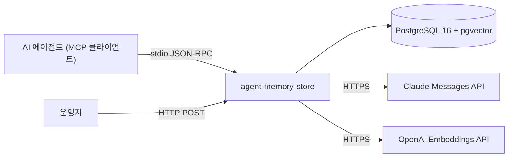

# agent-memory-store 소프트웨어 요구사항 명세서 (SRS)

| 문서 | 버전 | 작성일 | 기준 표준 |
|---|---|---|---|
| agent-memory-store SRS | 1.0 | 2026-11-18 | ISO/IEC/IEEE 29148:2018 |

## 1. 소개

### 1.1 목적

이 문서는 agent-memory-store가 만족해야 하는 기능/비기능 요구사항과 그 검증 근거를 정의합니다. 설계는 [SDS.md](SDS.md)에서 다룹니다.

### 1.2 범위

agent-memory-store는 AI 에이전트가 세션을 넘어 기억을 쓰고 다시 꺼내 쓰게 해 주는 전용 메모리 서버입니다. 논문 arXiv:2606.24775의 4모듈 구조(표현/저장, 추출, 검색/라우팅, 유지보수)를 구현하고, 그중 유지보수 모듈(모순 해소, 감쇠/망각, 정정 전파)에 비중을 둡니다.

범위 내:
- 4모듈 전체: 저장(무손실 로그 + fact), 추출, 검색/라우팅(예산 포함), 유지보수(충돌 해소, 감쇠, 전파)
- MCP 서버와 7개 툴
- MemFail 스타일 벤치마크 스위트, 하니스, 리포트
- 3세션 데모 스크립트와 README
- docker compose 기반 로컬 실행 환경

범위 외 항목은 [부록 B](#부록-b-범위-외-항목)에 있습니다.

### 1.3 제품 개요

#### 1.3.1 제품 관점

독립 실행형 Spring Boot 서버입니다. 에이전트는 stdio JSON-RPC(MCP)로 호출하고, 서버는 PostgreSQL + pgvector에 데이터를 저장하며, 필요할 때 외부 LLM과 임베딩 API를 호출합니다.

LLM과 임베딩은 기본값이 fake 프로바이더라 외부 API 없이도 동작합니다.

#### 1.3.2 제품 기능

- 세션 발화를 append-only 로그로 무손실 보관
- LLM으로 기억할 가치가 있는 사실(fact)을 추출하고 출처 발화에 연결
- 유사도, 최근성, 신뢰도 가중 점수로 검색하고 토큰 예산 안에 맞춰 반환
- 모순되는 사실을 우선순위 규칙으로 해소 (supersede / retract)
- 유형별 반감기로 오래된 사실을 expired 처리 (삭제 없음)
- 정정 시 연결된 사실에 needs_review를 전파하고 유지보수 잡이 재평가
- 위 기능을 MCP 툴 7개로 노출
- 벤치마크 하니스와 데모 스크립트

#### 1.3.3 사용자 특성

| 사용자 | 특성 | 사용 상황 |
|---|---|---|
| AI 에이전트 (Claude Code 등 MCP 클라이언트) | 사람이 아닌 프로그램. 툴 설명과 JSON 스키마만 보고 호출합니다. | 발화 로그 적재, 사실 추출, 다음 세션에서 예산 안의 기억 검색 |
| 개발자 / 운영자 | Java, Docker, Gradle 사용 가능 | 로컬 기동, 유지보수 잡 수동 실행, 벤치마크와 데모 실행 |

#### 1.3.4 제한 사항

| 항목 | 내용 |
|---|---|
| 언어 / 런타임 | Java 21 (Gradle toolchain) |
| 프레임워크 | Spring Boot 3.3.4 (web, data-jpa, actuator) |
| 데이터베이스 | PostgreSQL 16 + pgvector (`pgvector/pgvector:pg16`), Flyway 마이그레이션 V1~V4 |
| LLM | Claude Messages API, 모델 id는 `MEMSTORE_LLM_MODEL` (기본 `claude-opus-4-8`) |
| 임베딩 | `openai` 또는 `fake` (`EMBEDDING_PROVIDER`), 차원 1536 |
| 테스트 | JUnit 5, Testcontainers 1.21.3, jqwik 1.9.0, Mockito |
| 실행 환경 | 로컬 단일 사용자, Docker(docker compose)로 DB 기동 |

### 1.4 용어 정의

| 용어 | 의미 |
|---|---|
| session | 에이전트 대화 세션 1개. 발화의 묶음입니다. |
| utterance | 세션 안의 원문 발화 1개. 수정/삭제가 불가능한 append-only 로그입니다. |
| fact | 발화에서 추출한 사실. 유형은 `preference`, `constraint`, `decision`, `event`, `entity` 중 하나입니다. |
| provenance | fact와 출처 utterance의 연결. 모든 fact는 1개 이상 가져야 합니다. |
| relation | fact 사이 관계. `contradicts`, `supersedes`, `refines`, `duplicates` 중 하나입니다. |
| status | fact의 상태. `active`, `superseded`(더 새로운 사실로 대체), `retracted`(정정/망각으로 철회), `expired`(감쇠로 소프트 망각) 중 하나입니다. 행은 삭제하지 않습니다. |
| needs_review | 재검토가 필요한 fact에 붙는 플래그. status와 별개입니다. |
| confidence | fact의 신뢰도(0~1). 명시적 진술 0.9, 추론 0.6으로 시작합니다. |
| 반감기 (half-life) | 최근성과 신뢰도가 절반으로 줄어드는 기간(일). fact 유형별로 다릅니다. |
| budget_tokens | 검색 결과에 허용되는 추정 토큰 수 상한. |
| dedupe | 이미 있는 사실과 같은 사실을 새로 만들지 않고 기존 사실을 확인(confirm) 처리하는 것. |
| MCP | Model Context Protocol. 에이전트가 외부 툴을 JSON-RPC로 호출하는 프로토콜입니다. |
| pgvector | PostgreSQL에서 벡터 컬럼과 유사도 검색을 제공하는 확장입니다. |
| fake 프로바이더 | API 키 없이 결정적으로 동작하는 LLM/임베딩 대체 구현. 테스트, 데모, 벤치의 기본값입니다. |

## 2. 참고 문서

| 문서 | 내용 |
|---|---|
| [SDS.md](SDS.md) | 설계 명세: 구성도, 시퀀스, ERD, 모듈 |
| [README.md](../README.md) | 개요, 빠른 시작, 데모 출력 예시 |
| [.planning/SPEC.md](../.planning/SPEC.md) | 원본 요구사항(R1~R9, N1~N5) |
| [.planning/grilling-post-impl.md](../.planning/grilling-post-impl.md) | 구현 후 기준별 검증 기록, p95 실측 |
| [bench-report.md](../bench-report.md) | 벤치마크 결과 |
| [bench/MEMFAIL-NOTES.md](../bench/MEMFAIL-NOTES.md) | MemFail 원본 사용 가능성 조사 |
| arXiv:2606.24775 | 에이전트 메모리 4모듈 구조 |
| arXiv:2605.26667 | MemFail 벤치마크 |
| MCP 사양 2024-11-05 | 서버가 응답하는 protocolVersion |

## 3. 요구사항

모든 기능 요구사항은 원본 명세의 요구사항 절에 있는 항목이므로 우선순위는 필수입니다.

### 3.1 기능 요구사항

#### FR-1 무손실 발화 로그와 출처 연결 사실 저장

| 설명 | 우선순위 | 출처 | 검증 방법 |
|---|---|---|---|
| 시스템은 세션 원문 로그를 무손실 보관하고, 추출된 사실을 출처 발화 링크와 상태 이력과 함께 저장해야 한다. | 필수 | SPEC R1 | 시험 |

수용 기준:
- FR-1.1 세션 로그를 append한 뒤 원문이 바이트 단위로 동일하게 재조회됩니다.
- FR-1.2 감쇠/망각/정정 등 어떤 유지보수 연산 후에도 utterance 행 수가 줄지 않습니다.
- FR-1.3 fact의 status, confidence, last_confirmed_at, superseded_by가 저장되고, 상태 전이 시 invalidated_at이 기록됩니다.
- FR-1.4 fact_provenance로 fact에서 출처 utterance를 역참조 조회할 수 있습니다.

#### FR-2 LLM 기반 사실 추출과 중복 제거

| 설명 | 우선순위 | 출처 | 검증 방법 |
|---|---|---|---|
| 시스템은 세션 로그에서 LLM으로 기억할 가치가 있는 사실만 추출해야 하며, 추출된 모든 사실은 출처 발화에 링크되어야 한다. | 필수 | SPEC R2 | 시험 |

수용 기준:
- FR-2.1 데모 세션 로그를 넣으면 preference, constraint, decision 유형 사실이 각 1개 이상 추출됩니다.
- FR-2.2 추출된 모든 fact는 1개 이상의 provenance 링크를 가집니다. 유효한 출처가 없는 후보는 거부됩니다.
- FR-2.3 기억할 가치가 없는 세션(잡담만)은 0건 추출되고 오류가 없습니다.
- FR-2.4 같은 사실을 다시 추출하면 새 fact를 만들지 않고 기존 fact를 확인 처리합니다(confidence +0.1, 상한 0.95, last_confirmed_at 갱신). 판정은 임베딩 유사도 0.92 이상 + LLM 동일성 확인입니다.

#### FR-3 가중 점수 검색과 토큰 예산 패킹

| 설명 | 우선순위 | 출처 | 검증 방법 |
|---|---|---|---|
| 시스템은 `score = 0.55*유사도 + 0.25*최근성 + 0.20*신뢰도`로 랭킹하고, 지정된 토큰 예산(기본 2000, 상한 8000)을 넘지 않는 결과 묶음을 반환해야 한다. | 필수 | SPEC R3 | 시험 |

수용 기준:
- FR-3.1 가중 점수 공식이 고정 입력에 대해 기대한 값과 랭킹을 냅니다. 최근성은 `exp(-ln2 * 경과일 / 유형별 반감기)`입니다.
- FR-3.2 임의 입력 조합에서 응답의 추정 토큰 합이 예산을 넘지 않습니다(property 테스트 100케이스).
- FR-3.3 예산보다 큰 단일 사실은 건너뛰고 다음 사실을 채웁니다. 아무것도 못 채우면 빈 결과와 경고 필드를 반환합니다.
- FR-3.4 기본 검색은 superseded/retracted/expired 사실을 반환하지 않습니다. `include_inactive=true`면 전체를 조회합니다.
- FR-3.5 사실 10,000건을 시드한 뒤 검색 내부 처리(외부 임베딩 API 호출 제외)의 p95가 500ms 미만입니다.

#### FR-4 모순 충돌 해소

| 설명 | 우선순위 | 출처 | 검증 방법 |
|---|---|---|---|
| 시스템은 새 사실이 기존 활성 사실과 모순되면 우선순위 규칙(명시적 정정 > 최신 세션 > 최신 발화)에 따라 한쪽을 supersede 또는 retract 해야 한다. | 필수 | SPEC R4 | 시험 |

수용 기준:
- FR-4.1 "3월 세션에서 A, 6월 세션에서 B" 시나리오에서 검색은 B만 반환하고, A는 superseded이며 superseded_by가 B를 가리킵니다.
- FR-4.2 같은 세션 안의 모순은 나중 발화의 사실이 이깁니다.
- FR-4.3 같은 발화 안의 모순은 둘 다 저장되고 둘 다 needs_review 플래그를 가집니다.
- FR-4.4 retracted 사실과 같은 진술이 이후 다시 나타나면 자동으로 active로 부활하지 않고 needs_review로 저장됩니다.
- FR-4.5 추출 중 정정 화행이 감지되면 정정이 더 오래된 세션에서 왔더라도 이깁니다. 대상은 retracted, 정정 사실 confidence는 0.95입니다.

#### FR-5 유형별 반감기 감쇠와 소프트 망각

| 설명 | 우선순위 | 출처 | 검증 방법 |
|---|---|---|---|
| 시스템은 유효 신뢰도 `confidence * exp(-ln2 * last_confirmed_at 이후 경과일 / 반감기)`가 0.15 미만인 사실을 expired로 전환해야 하며, 행을 삭제해서는 안 된다. | 필수 | SPEC R5 | 시험 |

수용 기준:
- FR-5.1 유형별 반감기 감쇠 공식이 단위 테스트를 통과합니다(반감기만큼 지나면 0.5배).
- FR-5.2 last_confirmed_at을 과거로 조작한 event 사실이 유지보수 실행 후 expired로 전환됩니다.
- FR-5.3 expired 전환 후에도 행이 남고 `include_inactive=true` 검색으로 조회됩니다.
- FR-5.4 검색 접근은 last_confirmed_at을 갱신하지 않습니다. 재추출 확인 또는 정정만 갱신합니다.

#### FR-6 정정 전파와 재평가

| 설명 | 우선순위 | 출처 | 검증 방법 |
|---|---|---|---|
| 시스템은 사실이 retracted 또는 superseded 되면 관계로 연결된 사실(깊이 2 이내)에 needs_review를 표시하고, 유지보수 잡이 상한 안에서 재평가해야 한다. | 필수 | SPEC R6 | 시험 |

수용 기준:
- FR-6.1 A를 refines하는 B가 있을 때 A를 정정하면 B에 needs_review가 표시됩니다.
- FR-6.2 순환 관계(A와 B가 서로 연결)에서도 전파가 무한루프 없이 끝납니다.
- FR-6.3 needs_review 사실은 검색 점수에서 신뢰도 0.5배 페널티를 받습니다.
- FR-6.4 유지보수 잡 1회 실행의 LLM 호출은 50회 이하이고, 재평가는 실행당 20건 이하입니다.

#### FR-7 MCP 툴 7개 노출

| 설명 | 우선순위 | 출처 | 검증 방법 |
|---|---|---|---|
| 시스템은 7개 MCP 툴(`memory_log_append`, `memory_extract`, `memory_search`, `memory_save_fact`, `memory_correct`, `memory_forget`, `memory_inspect`)을 노출하고, MCP 클라이언트에서 왕복 호출되어야 한다. | 필수 | SPEC R7 | 시험, 시연 |

수용 기준:
- FR-7.1 `tools/list`가 7개 툴과 파라미터 스키마를 반환합니다.
- FR-7.2 MCP 클라이언트(Claude Code 또는 MCP inspector)에서 `memory_search` 왕복 호출이 성공합니다.
- FR-7.3 `memory_correct` 호출이 충돌 해소(대상 retract)와 정정 전파를 실제로 트리거합니다.
- FR-7.4 `memory_save_fact`로 저장한 fact도 합성 provenance를 가지며, provenance 없는 fact는 만들 수 없습니다.

#### FR-8 MemFail 스타일 벤치마크

| 설명 | 우선순위 | 출처 | 검증 방법 |
|---|---|---|---|
| 시스템은 시나리오 스위트를 하니스로 실행해 카테고리별 통과 수를 산출해야 하며, 전체 정답률 80% 이상을 달성해야 한다. | 필수 | SPEC R8 | 분석, 검사 |

수용 기준:
- FR-8.1 MemFail 원본 데이터셋 사용 가능성 조사 결과가 기록됩니다.
- FR-8.2 자체 스위트가 30개 이상이며 카테고리 구성(모순 10, 정정 8, 감쇠 6, 출처 3, 예산 3)을 만족합니다.
- FR-8.3 하니스 1회 실행으로 카테고리별 통과/전체 표가 담긴 `bench-report.md`가 생성됩니다.
- FR-8.4 전체 정답률과 모순 카테고리 정답률이 각각 80% 이상입니다.

#### FR-9 3세션 데모

| 설명 | 우선순위 | 출처 | 검증 방법 |
|---|---|---|---|
| 시스템은 3세션 데모 시나리오를 스크립트 한 번으로 재현해 충돌 해소, 출처 추적, 예산 패킹을 보여 주어야 한다. | 필수 | SPEC R9 | 시연 |

수용 기준:
- FR-9.1 `demo/run-demo.sh` 1회 실행으로 3세션 시드와 4개 질의 결과가 출력됩니다.
- FR-9.2 "PostgreSQL version" 질의에 17만 나오고, inspect로 15의 superseded 이력과 출처 발화가 확인됩니다.
- FR-9.3 README에 실행 방법과 데모 출력 예시가 있습니다.

### 3.2 성능 요구사항

| ID | 요구사항 | 목표치 | 검증 방법 |
|---|---|---|---|
| NFR-1 | 사실 10,000건에서 검색 내부 처리 지연 (외부 임베딩 API 호출 제외) | p95 500ms 미만 | 시험 (`SearchIntegrationTest.r3a5_*`) |
| NFR-2 | 유지보수 잡 1회 실행의 LLM 호출 수 | 50회 이하, 재평가 20건 이하 | 시험 (`ReviewIntegrationTest.r6a4_*`) |

### 3.3 사용성 요구사항

해당 없음. 사람용 UI가 없고, 사용자는 MCP 클라이언트입니다. 툴별 용도는 `tools/list`의 설명문과 JSON 스키마로 전달합니다(3.4).

### 3.4 인터페이스 요구사항

| 구분 | ID | 인터페이스 | 요구사항 |
|---|---|---|---|
| 사용자 | - | MCP 툴 7개 | 에이전트는 MCP 툴로만 기억을 읽고 씁니다. 툴 목록은 FR-7. |
| 사용자 | - | Gradle 태스크 | `bootRun`, `bootJar`, `test`, `benchRun`, `demoRun` |
| 소프트웨어 | - | PostgreSQL 16 + pgvector | JDBC (`MEMSTORE_DB_URL`, 기본 `jdbc:postgresql://localhost:5432/memstore`) |
| 소프트웨어 | - | Claude Messages API | `POST /v1/messages`, `anthropic-version 2023-06-01` (`MEMSTORE_LLM_PROVIDER=claude`일 때) |
| 소프트웨어 | - | OpenAI Embeddings API | `POST /embeddings` (`EMBEDDING_PROVIDER=openai`일 때) |
| 통신 | NFR-3 | MCP 전송 | JSON-RPC 2.0, stdio 줄 단위 전송, protocolVersion `2024-11-05` (`-Dmemstore.mcp.stdio=true`) |
| 통신 | NFR-4 | 운영 HTTP | `POST /internal/maintenance/run`, `GET /actuator/health` (Spring Boot 기본 포트) |

### 3.5 논리 데이터 요구사항

| 데이터 | 보존 요구 |
|---|---|
| session | 세션 출처(source), 시작/종료 시각, metadata를 보관합니다. |
| utterance | 원문을 바이트 그대로 영구 보관합니다. 세션 안에서 순번(seq)이 유일합니다. 수정/삭제 불가. |
| fact | 진술, 유형, 임베딩과 임베딩 모델 id, confidence, status, needs_review, 생성/확인/무효화 시각, 대체한 사실 포인터를 보관합니다. 행은 삭제하지 않습니다. |
| fact_provenance | fact와 출처 utterance의 다대다 연결. fact마다 1개 이상 필수입니다. |
| fact_relation | fact 사이 관계(contradicts, supersedes, refines, duplicates). 같은 (from, to, relation)은 1번만 저장합니다. |

상세 스키마는 [SDS 3.4 정보 뷰](SDS.md#34-정보-뷰)에 있습니다.

### 3.6 설계 제약

- 스키마는 Flyway 마이그레이션이 소유하고, Hibernate는 스키마를 만들거나 바꾸지 않습니다(`ddl-auto: none`).
- utterance 불변성은 애플리케이션이 아니라 DB 트리거로 강제합니다.
- LLM과 임베딩은 프로바이더 인터페이스(`LlmClient`, `EmbeddingProvider`)로 추상화하고, 환경변수로 구현을 고릅니다.
- 임베딩 컬럼은 `vector(1536)` 고정이므로 임베딩 차원은 1536이어야 합니다.
- 가중치, 반감기, 예산, 임계치, 유지보수 상한은 `application.yml`의 설정값입니다.

### 3.7 소프트웨어 시스템 속성

| ID | 속성 | 요구사항 | 목표치 |
|---|---|---|---|
| NFR-5 | 신뢰성 | 어떤 상태 전이도 fact/utterance 행을 삭제하지 않음 | 삭제 경로 0개 |
| NFR-6 | 신뢰성 | 테스트, 데모, 벤치가 외부 키 없이 같은 결과를 냄 | 기본 프로바이더 `fake` |
| NFR-7 | 이식성 | 현재 임베딩 모델로 만든 임베딩만 검색 대상 (모델 혼합 거부) | `embedding_model` 일치 필터 |
| NFR-8 | 보안 | API 키와 DB 비밀번호는 환경변수로만 주입 | 저장소에 키 없음 (`application.yml` 기본값 공백) |
| NFR-9 | 유지보수성 | 유지보수 잡 자동 실행과 수동 실행 | 매일 03:00 (`memstore.maintenance.cron`), `POST /internal/maintenance/run` |
| NFR-10 | 유지보수성 | CI에서 전체 테스트 실행 | push(master)/PR마다 `./gradlew test` |

### 3.8 금지 조건 (must-NOT)

- N1. utterance(원문 로그)를 수정하거나 삭제하는 코드 경로가 없어야 합니다. DB 트리거가 행 단위 UPDATE/DELETE를 막습니다.
- N2. 기본 검색은 비활성 사실(superseded/retracted/expired)을 반환하지 않습니다.
- N3. 검색 결과는 컨텍스트 예산(budget_tokens)을 넘지 않습니다.
- N4. provenance 없는 fact는 만들어지지 않습니다.
- N5. 유지보수 잡은 LLM을 무제한 호출하지 않습니다.

## 4. 검증

### 4.1 검증 방법

| 방법 | 대상 | 실행 |
|---|---|---|
| 시험 - 단위 | 점수 공식, 토큰 추정, 예산 패킹, 감쇠 공식, 충돌 후보 창 경계 (Mockito) | `./gradlew test` (Docker 불필요) |
| 시험 - property | 예산 초과 금지 (jqwik 100케이스) | `./gradlew test` |
| 시험 - 통합 | 저장, 추출, 검색, 충돌, 감쇠, 전파, 재평가, MCP (실제 PostgreSQL + pgvector, fake 프로바이더) | `./gradlew test`. Docker가 있으면 Testcontainers, 없으면 skip. 외부 DB는 `-Dmemstore.test.jdbcUrl=...` |
| 분석 | 벤치마크 30개 시나리오의 카테고리별 통과율 | `./gradlew benchRun` - `bench-report.md` 생성, 전체 80% 미만이면 종료 코드 1 |
| 시연 | 3세션 데모 | `bash demo/run-demo.sh` |
| 검사 | 문서/설정 파일 확인 | 해당 파일 열람 |

### 4.2 요구사항 추적표

구현 위치는 `src/main/java/dev/nini/memstore/` 기준, 테스트는 `src/test/java/dev/nini/memstore/` 기준 상대 경로입니다.

| ID | 요구사항 | 구현 위치 | 검증 근거 | 상태 |
|---|---|---|---|---|
| FR-1.1 | 원문 바이트 동일 재조회 | `service/SessionLogService.java` | `StorageIntegrationTest.r1a1_appendedContentIsByteIdenticalOnReRead` | 충족 |
| FR-1.2 | 유지보수 후 utterance 행 수 유지 | `service/FactStore.java`, `V3__utterance_immutable_trigger.sql` | `StorageIntegrationTest.r1a2_utteranceCountDoesNotDecreaseAfterTransition` | 충족 |
| FR-1.3 | 상태/신뢰도/전이 기록 | `service/FactStore.java` (`transition`, `confirm`) | `StorageIntegrationTest.r1a3_statusTransitionRecordsFields` | 충족 |
| FR-1.4 | provenance 역참조 | `service/FactStore.java` (`provenanceUtterances`) | `StorageIntegrationTest.r1a4_provenanceReverseLookupWorks` | 충족 |
| FR-2.1 | 3유형 추출 | `extraction/ExtractionService.java`, `llm/FakeLlmClient.java` | `ExtractionIntegrationTest.r2a1_extractsPreferenceConstraintDecision` | 충족 |
| FR-2.2 | 추출 fact 모두 provenance 보유 | `extraction/ExtractionService.java`, `service/FactStore.java` | `ExtractionIntegrationTest.r2a2_everyFactHasProvenance` | 충족 |
| FR-2.3 | 잡담 0건 추출 | `llm/FakeLlmClient.java` | `ExtractionIntegrationTest.r2a3_chitchatYieldsNothing` | 충족 |
| FR-2.4 | 재추출 시 확인 처리 | `extraction/ExtractionService.java` (`findDuplicate`), `service/FactStore.java` (`confirm`) | `ExtractionIntegrationTest.r2a4_reExtractionConfirmsInsteadOfDuplicating` | 충족 |
| FR-3.1 | 가중 점수 공식과 랭킹 | `search/ScoringPolicy.java` | `ScoringBudgetTest.r3a1_scoreFormulaMatchesExpectedValues`, `r3a1_expectedRanking` | 충족 |
| FR-3.2 | 예산 초과 금지 | `search/BudgetPacker.java`, `search/TokenEstimator.java` | `BudgetPackerPropertyTest.packedTotalNeverExceedsBudget` | 충족 |
| FR-3.3 | 큰 사실 건너뛰기, 빈 결과 경고 | `search/BudgetPacker.java` | `ScoringBudgetTest.r3a3_oversizedFactSkippedAndNextFilled`, `r3a3_nothingFitsReturnsEmptyWithWarning` | 충족 |
| FR-3.4 | 기본 검색 비활성 제외 | `search/MemorySearchService.java` | `SearchIntegrationTest.r3a4_defaultSearchExcludesInactiveFacts` | 충족 |
| FR-3.5 | 10k p95 < 500ms | `search/FactVectorSearch.java`, `V4__fact_embedding_index.sql` | `SearchIntegrationTest.r3a5_searchP95Under500msAt10kFacts`, 실측 p95 22.5ms (`.planning/grilling-post-impl.md`) | 충족 |
| FR-4.1 | 최신 세션 승리 | `extraction/DefaultConflictResolver.java` | `ConflictIntegrationTest.r4a1_newerSessionWinsAcrossSessions` | 충족 |
| FR-4.2 | 같은 세션 나중 발화 승리 | `extraction/DefaultConflictResolver.java` (`compareRecency`) | `ConflictIntegrationTest.r4a2_laterUtteranceWinsWithinSession` | 충족 |
| FR-4.3 | 같은 발화 모순 둘 다 needs_review | `extraction/DefaultConflictResolver.java` | `ConflictIntegrationTest.r4a3_sameUtteranceKeepsBothAsNeedsReview` | 충족 |
| FR-4.4 | retracted 자동 부활 금지 | `extraction/DefaultConflictResolver.java` (`matchesRetracted`) | `ConflictIntegrationTest.r4a4_retractedStatementReappearsAsNeedsReviewWithoutRevival` | 충족 |
| FR-4.5 | 추출 경로 명시적 정정 우선 | `extraction/DefaultConflictResolver.java` (`resolveContradiction`) | `ConflictIntegrationTest.r4_explicitCorrectionOutranksNewerSession`, `r4_extractionDetectedCorrectionRetractsTarget` | 충족 |
| FR-5.1 | 감쇠 공식 | `maintenance/DecayPolicy.java` | `DecayPolicyTest.r5a1_halfLifeElapsedHalvesConfidence` | 충족 |
| FR-5.2 | 오래된 event expired 전환 | `maintenance/DecayStep.java` | `MaintenanceIntegrationTest.r5a2_a3_agedEventExpiresAndIsPreservedForInclusiveSearch` | 충족 |
| FR-5.3 | expired 행 보존 + inclusive 조회 | `maintenance/DecayStep.java`, `search/MemorySearchService.java` | `MaintenanceIntegrationTest.r5a2_a3_agedEventExpiresAndIsPreservedForInclusiveSearch` | 충족 |
| FR-5.4 | 검색이 last_confirmed_at 미갱신 | `search/MemorySearchService.java` (readOnly 트랜잭션) | `MaintenanceIntegrationTest.r5a4_searchDoesNotUpdateLastConfirmedAt` | 충족 |
| FR-6.1 | refines 이웃 needs_review | `extraction/DefaultPropagationService.java` | `PropagationIntegrationTest.r6a1_correctingAFlagsRefiningB` | 충족 |
| FR-6.2 | 순환 전파 종료 | `extraction/DefaultPropagationService.java` (visited 집합) | `PropagationIntegrationTest.r6a2_cyclicRelationsTerminate` | 충족 |
| FR-6.3 | needs_review 0.5배 페널티 | `search/ScoringPolicy.java` | `ReviewIntegrationTest.r6a3_needsReviewFactRanksBelowIdenticalActiveFact` | 충족 |
| FR-6.4 | LLM 호출 50회, 재평가 20건 상한 | `maintenance/ReviewStep.java`, `maintenance/LlmCallBudget.java` | `ReviewIntegrationTest.r6a4_maintenanceRespectsLlmCallBudget` | 충족 |
| FR-7.1 | tools/list 7개 툴 | `mcp/McpServer.java` | `McpIntegrationTest.r7a1_toolsListExposesSevenTools` | 충족 |
| FR-7.2 | 외부 MCP 클라이언트 왕복 | `mcp/McpStdioServer.java`, `mcp/McpServer.java` | in-process 왕복만 검증 (`McpIntegrationTest.r7a2_searchRoundTripSucceeds`). Claude Code / inspector 실왕복 기록 없음 | 미검증 |
| FR-7.3 | memory_correct가 해소와 전파 트리거 | `mcp/McpToolService.java`, `extraction/CorrectionService.java` | `McpIntegrationTest.r7a3_correctTriggersConflictAndPropagation` | 충족 |
| FR-7.4 | save_fact 합성 provenance | `mcp/McpToolService.java` (`saveFact`) | `McpIntegrationTest.r7a4_saveFactHasSyntheticProvenance` | 충족 |
| FR-8.1 | MemFail 조사 기록 | - | `bench/MEMFAIL-NOTES.md` | 충족 |
| FR-8.2 | 시나리오 30개, 10/8/6/3/3 | `bench/scenarios/*.yaml` | 시나리오 파일 5개의 id 수 10/8/6/3/3 | 충족 |
| FR-8.3 | bench-report.md 생성 | `bench/BenchHarness.java`, `bench/BenchRunner.java` | `bench-report.md` | 충족 |
| FR-8.4 | 전체/모순 80% 이상 | `bench/BenchHarness.java` | `bench-report.md` 30/30, 모순 10/10. fake 프로바이더 기준이며 실모델 결과는 없음 | 충족 |
| FR-9.1 | 데모 1회 실행 출력 | `demo/DemoRunner.java`, `demo/run-demo.sh` | README "데모 출력 예시" | 충족 |
| FR-9.2 | 17만 반환, 15의 이력/출처 | `demo/DemoRunner.java` | README "데모 출력 예시" Q1, Q2 | 충족 |
| FR-9.3 | README 실행 방법/출력 예시 | `README.md` | README "빠른 시작", "데모 출력 예시" | 충족 |
| NFR-1 | 검색 p95 | FR-3.5와 동일 | FR-3.5와 동일 | 충족 |
| NFR-2 | LLM 호출 상한 | `maintenance/LlmCallBudget.java`, `config/MaintenanceProperties.java` | FR-6.4와 동일 | 충족 |
| NFR-3 | MCP 프로토콜 | `mcp/McpServer.java`, `mcp/McpStdioServer.java` | `McpIntegrationTest` (in-process). 외부 클라이언트 stdio 실왕복 기록 없음 | 미검증 |
| NFR-4 | 운영 HTTP | `maintenance/MaintenanceController.java`, `application.yml` (actuator) | 엔드포인트 자동 테스트 없음 | 미검증 |
| NFR-5 | 행 보존 | `service/FactStore.java` (상태 전이만), `V3__utterance_immutable_trigger.sql` | `StorageIntegrationTest.r1a2_*`, `n1_utteranceUpdateAndDeleteBlockedByTrigger` | 충족 |
| NFR-6 | 결정성 | `llm/FakeLlmClient.java`, `embedding/FakeEmbeddingProvider.java` | 전체 테스트와 `bench-report.md`가 fake 프로바이더로 실행됨 | 충족 |
| NFR-7 | 임베딩 모델 혼합 거부 | `search/FactVectorSearch.java` | `EmbeddingVectorSearchIntegrationTest.factsWithDifferentEmbeddingModelAreExcluded` | 충족 |
| NFR-8 | 키는 환경변수로만 | `src/main/resources/application.yml` | 설정 파일 검사 (자동 테스트 없음) | 미검증 |
| NFR-9 | 유지보수 스케줄/수동 실행 | `maintenance/MaintenanceJob.java`, `maintenance/MaintenanceController.java` | 스케줄/엔드포인트 자동 테스트 없음 (`MaintenanceIntegrationTest`는 잡을 직접 호출) | 미검증 |
| NFR-10 | CI 테스트 | `.github/workflows/ci.yml` | 워크플로 파일 | 충족 |
| N1 | utterance 수정/삭제 금지 | `V3__utterance_immutable_trigger.sql`, `repo/UtteranceRepository.java` | `StorageIntegrationTest.n1_utteranceUpdateAndDeleteBlockedByTrigger` | 충족 |
| N2 | 비활성 반환 금지 | FR-3.4와 동일 | FR-3.4와 동일 | 충족 |
| N3 | 예산 초과 금지 | FR-3.2와 동일 | FR-3.2와 동일 | 충족 |
| N4 | provenance 없는 fact 금지 | `service/FactStore.java` (`saveAt`) | `StorageIntegrationTest.n4_factWithoutProvenanceIsRejected`, FR-2.2, FR-7.4 | 충족 |
| N5 | LLM 무제한 호출 금지 | FR-6.4와 동일 | FR-6.4와 동일 | 충족 |

## 부록 A. 가정과 의존성

- 로컬 단일 사용자 환경을 가정합니다. 인증과 동시 다중 사용자는 고려하지 않습니다.
- 통합 테스트는 Docker(Testcontainers) 또는 외부 PostgreSQL + pgvector에 의존합니다. 둘 다 없으면 통합 테스트는 skip됩니다.
- 위 검증 근거는 모두 fake LLM/임베딩 프로바이더 기준입니다. `ClaudeLlmClient`와 `OpenAiEmbeddingProvider`의 실호출은 검증되지 않았습니다.
- LLM 결정성은 고정 프롬프트에 의존합니다. Claude 클라이언트는 temperature 파라미터를 보내지 않습니다(사용 모델이 sampling 파라미터를 거부하기 때문).
- 유사도 임계치(0.80, 0.92)는 `(1 + cosine) / 2`로 정규화한 유사도에 적용됩니다. 실 임베딩 모델로 바꾸면 재조정이 필요할 수 있습니다.

## 부록 B. 범위 외 항목

| 항목 | 이유 |
|---|---|
| 웹 UI / 대시보드 | 소비자는 에이전트이며 `memory_inspect`로 충분합니다. |
| 인증 / 멀티테넌시 | 로컬 단일 사용자 전제입니다. |
| 임베디드(Rust/Go) 변형 | 스택은 Java/Spring 서버형으로 확정했습니다. |
| 임베딩 모델 교체 시 재임베딩 마이그레이션 | `embedding_model`을 기록해 혼합을 거부하는 것까지만 합니다. |
| 깊이 2를 넘는 그래프 추론 | 전파는 깊이 2가 상한입니다. |
| 실시간 스트리밍 추출 | 세션 단위 배치 추출로 충분합니다. |
| MemFail 원본 점수 재현 | 원본 지표 재현 자체는 목표가 아닙니다. |
| 다국어 임베딩 최적화 | 임베딩 프로바이더 성능에 맡깁니다. |
| 분산 / 샤딩 / 고가용성 | 단일 PostgreSQL 전제입니다. |
